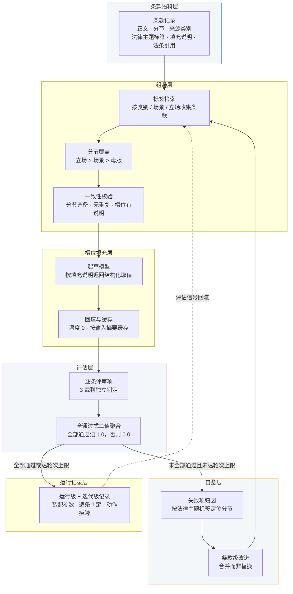

# 图 1 架构图：生图提示词与 Mermaid 源

> 按 `figures-diagram` 技能生成。架构图属示意类，不由数据生成，故不产出 CSV。
> 正文（2.1 节）已引用"图 1"，投稿前需以下两种方式之一产出实体图件：
> ① 用下方提示词交给生图 AI；② 直接用 Mermaid 源渲染（推荐，元素与连线精确可控）。

## 一、Mermaid 源（推荐，可直接渲染）



## 二、生图 AI 提示词

```
绘制一个学术论文级别的系统架构图，展示"law-bench：面向中文合同起草的评估闭环与自愈式生成系统"。

【整体布局】
- 布局方向：从上到下，六层纵向排列，层间用箭头连接
- 背景颜色：白色
- 风格：专业学术风格，扁平化，无阴影渐变
- 分辨率：450 DPI

【具体内容】
自顶向下六层，每层一个圆角矩形分区，区内标注层名与关键动作：

第 1 层「条款语料层」：条款记录，含正文、分节、来源类别、法律主题标签、填充说明、法条引用。

第 2 层「组装层」：按标签检索条款；按分节覆盖（立场优先于场景、场景优先于母版）；渲染前一致性校验（分节齐备、无重复、每个占位符有填充说明）。

第 3 层「槽位填充层」：起草模型按填充说明返回以占位符名为键的结构化取值；回填正文并按输入摘要缓存，温度固定为零。

第 4 层「评估层」：每条评审项由 3 个裁判独立判定；全通过式二值聚合——全部评审项通过记 1.0，任一不通过记 0.0。

第 5 层「自愈层」：失败项按法律主题标签归因到分节；生成条款级改进，采用合并而非替换的更新策略。

第 6 层「运行记录层」：运行级与迭代级两级记录，保存装配参数、逐条判定与动作痕迹。

【连线与反馈】
- 主链：第 1 层 → 第 2 层 → 第 3 层 → 第 4 层 → 第 6 层（箭头向下）。
- 反馈边一（闭环核心）：第 4 层在"未全部通过且未达轮次上限"时指向第 5 层，第 5 层再回到第 2 层，构成自愈闭环。
- 反馈边二：第 6 层的运行记录以虚线指回第 2 层，标注"评估信号回流"。
- 主链向下的箭头用实线深灰，反馈边用彩色实线并加粗，虚线反馈边用同色虚线，使"闭环"在视觉上突出。

【配色方案】
- #2E86AB（蓝）：主链箭头与第 1、2、3、6 层边框
- #A23B72（紫红）：第 4 层评估层边框
- #F18F01（橙）：第 5 层自愈层边框与闭环反馈边
- #F4F7FA（浅灰蓝）：各层填充底色
- #333333（深灰）：正文文字

【风格要求】
- 所有中文文字清晰可读，字号不小于 12pt
- 箭头流向清晰，反馈边与主链在视觉上可区分
- 层名加粗，层内动作用普通字重
- 不使用 3D 效果、不用阴影、不用装饰性图标
- 图内文字一律为中文，不使用英文缩写（如必须使用，首次出现处加中文注释）
```

## 三、注意事项

- 图中不得出现具体主机名、域名、集群名（按 AGENTS.md 对退役基础设施的处理要求）。
- 对象存储、数据库等部署细节属 2.4 节文字内容，不进架构图，避免与 2.4 重复。
- 若生图 AI 无法准确渲染中文，改用第一节的 Mermaid 源渲染，保真度更高。
